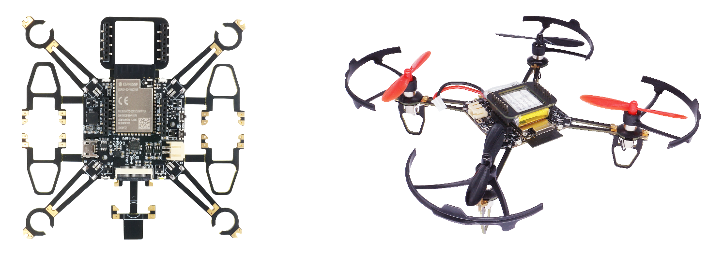


## ESP-Drone

* [English Version](./README.md)

### 简介

ESP-Drone 是面向乐鑫 SoC 的开源无人机解决方案。通过实物验证的飞行硬件可使用手机 app 或游戏手柄经 Wi-Fi 控制，并支持自稳定、定高和定点等飞行模式。该方案硬件结构简单，固件便于扩展，可用于 STEAM 教育和原型开发。飞行控制核心来自 Crazyflie 开源工程，使用 GPL-3.0 许可证。

> 本项目仅支持 ESP-IDF [release/v5.5](https://docs.espressif.com/projects/esp-idf/zh_CN/release-v5.5/esp32s2/get-started/index.html) 和 `release/v6.1`。ESP32-S31 必须使用 6.1 preview target；ESP32-P4 当前使用无无线安全诊断配置。P4/S31 飞行硬件仍需补充板级引脚定义和实物验证。

* **从这里开始**: [Getting Started](https://docs.espressif.com/projects/espressif-esp-drone/zh_CN/latest/gettingstarted.html)
* **硬件原理图**：[Hardware](https://docs.espressif.com/projects/espressif-esp-drone/zh_CN/latest/_static/ESP32_S2_Drone_V1_2/SCH_Mainboard_ESP32_S2_Drone_V1_2.pdf)
* **iOS APP 源代码**: [ESP-Drone-iOS](https://github.com/EspressifApps/ESP-Drone-iOS)
* **Android APP 源代码**: [ESP-Drone-Android](https://github.com/EspressifApps/ESP-Drone-Android)

### 功能

1. 自稳定模式
2. 定高模式
3. 定点模式
4. APP 控制
5. 适配 cfclient 上位机，参考 https://github.com/leeebo/crazyflie-clients-python
6. 通过 ESP-NOW 支持 ESP-BOX-3 遥控器

注意，定高模式及定点模式需外接扩展板，详情见硬件参考。

### 支持政策

自 2022 年 12 月起，我们仅提供有限的支持，但是 Pull Request 仍然是被欢迎的！

### 第三方代码

第三方代码及证书如下：

| 组件 | License | 源代码 |Commit ID |
| :---:  | :---: | :---: |:---: |
| core/crazyflie | GPL-3.0 |[Crazyflie](https://github.com/bitcraze/crazyflie-firmware/tree/2021.01) |tag_2021_01 b448553|
| lib/dsp_lib |  | [esp32-lin](https://github.com/whyengineer/esp32-lin/tree/master/components/dsp_lib) |6fa39f4c|

### 致谢

1. 感谢 Bitcraze 开源组织提供很棒的 [Crazyflie](https://www.bitcraze.io/) 无人机项目代码；
2. 感谢乐鑫提供 ESP32 和 [ESP-IDF 操作系统](https://docs.espressif.com/projects/esp-idf/en/latest/esp32s2/get-started/index.html)；
3. 感谢 WhyEngineer 提供的 stm32 dsp 移植库 [esp-dsp](https://github.com/whyengineer/esp32-lin/tree/master/components/dsp_lib)。
