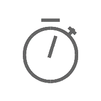
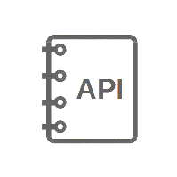
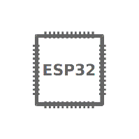

ESP-Drone
===========
:link_to_translation:`zh_CN:[中文]`

**ESP-Drone** is an open-source drone solution for Espressif SoCs. It can be controlled over **Wi-Fi** using a mobile app or gamepad. The project supports stabilized, height-hold, and position-hold flight modes on validated flight hardware. Its flight-control core is derived from **Crazyflie** and licensed under GPL-3.0.

This document describes the development guide for ESP-Drone project.

ESP-Drone Support Policy
-------------------------

From December 2022, we will offer limited support on this project, but Pull Request is still welcomed!

Supported versions and targets
------------------------------

Only ESP-IDF ``release/v5.5`` and ``release/v6.1`` are supported.

.. list-table::
   :header-rows: 1

   * - ESP-IDF
     - Targets
     - Status
   * - ``release/v5.5``
     - ESP32, ESP32-S2, ESP32-S3, ESP32-P4
     - CI build support; P4 uses the no-radio diagnostic profile
   * - ``release/v6.1``
     - ESP32, ESP32-S2, ESP32-S3, ESP32-P4, ESP32-S31
     - CI build support; S31 is a preview target and P4/S31 flight hardware is not yet validated

Get Started
------------

.. list-table::
   :widths: 1 1 1

   * - |Get Started|
     - |Develop Guide|
     - |H/W Reference|
   * - :doc:`Get Started <gettingstarted>`
     - :doc:`Develop Guide <developerguide>`
     - :doc:`H/W Reference <hardware>`

.. toctree::
   :hidden:

   Get Started <gettingstarted>
   Set up Development Environment <getespidf>
   Development Guide <developerguide>
   Hardware Reference <hardware>
   Drivers <drivers>
   Flight Control System <system>
   Communications <communication>
   Notice <notice>
